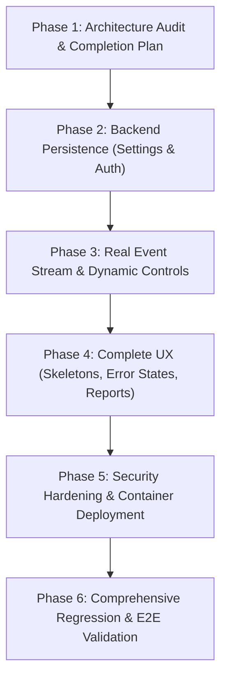

# DPDP-Guard: Website Engineering Completion Plan

## Executive Overview

DPDP-Guard is an evidence-grounded cybersecurity and privacy governance SaaS platform purpose-built for the India Digital Personal Data Protection Act (DPDP Act) 2023. The platform operationalizes the end-to-end investigation lifecycle:

$$\text{Scan} \longrightarrow \text{Discover Evidence} \longrightarrow \text{Investigate} \longrightarrow \text{Explain} \longrightarrow \text{Fix} \longrightarrow \text{Verify}$$

This plan establishes an exhaustive audit of the existing codebase at `D:\DPDP` and outlines the prioritized, phased engineering roadmap to make DPDP-Guard a 100% functional, reliable, professional cybersecurity SaaS website.

---

## 1. Inventory of Features Working End-to-End Today

| Feature / Subsystem | Implementation Details | Provenance & Safeguards |
| :--- | :--- | :--- |
| **Controlled Scan Lifecycle & Polling** | `backend/app/services/scan_service.py`, `src/pages/Scan.tsx`, `src/services/scanService.ts` | Authoritative database state (`queued`, `running`, `completed`, `failed`, `cancelled`), 5 discrete stages, real progress polling, cancellation support, background task recovery across browser reload. |
| **Real HTTP Fix & Verify Workbench** | `backend/app/services/verification_service.py`, `backend/app/api/routes/testbed.py`, `src/pages/FixVerify.tsx` | Live HTTP probe against `/testbed/api/v1/customers/...`, verifies BOLA authorization object mismatch (`DPDP_AUTH_OBJECT_MISMATCH`), checks absence of unauthorized PII (Aadhaar, PAN), verifies `x-dpdp-guard-enforced` header. Cannot produce false PASS. |
| **Compliance Audit History** | `backend/app/models/entities.py` (`AuditRecordModel`), `backend/app/api/routes/findings.py`, `src/services/remediationService.ts` | Immutable compliance verification trail stored in SQLite with `SET NULL` on delete, requiring explicit `?confirm=true` to clear audit logs. |
| **Data-Driven Privacy Flow Topology** | `src/pages/PrivacyFlow.tsx`, `src/services/privacyFlowService.ts`, `@xyflow/react` | Derives graph nodes and edges strictly from persisted `BrowserObservationModel` records; classifies first-party, third-party, and unconsented tracker violations; deterministic non-overlapping layout; clear synthetic provenance badges. |
| **Statutory Risk Index (Advisory)** | `src/pages/Overview.tsx`, `tests/dashboard_lifecycle.test.ts` | Qualitative technical exposure index strictly based on detected evidence (Section 6, 8, 9, 16); no hardcoded or fabricated metrics; explicit advisory disclaimer. |
| **Runtime API Base URL Configuration** | `src/services/apiConfig.ts`, `src/pages/Settings.tsx`, `src/services/api.ts` | Unified URL resolver, protocol normalization, trailing slash stripping, live memory propagation without rebuild, connectivity health testing with latency measurement. |
| **Egress Proxy & SSRF Protection** | `backend/app/services/network_interceptor.py`, `backend/app/services/egress_proxy.py` | Connection-time DNS resolution, rejection of RFC1918 private IPs/loopback/cloud metadata endpoints, authorized destination domain whitelist, proxy token authentication. |

---

## 2. Incomplete or Frontend-Only Features

1. **Organization & DPO Settings Persistence:**
   - `src/pages/Settings.tsx` and `src/services/api.ts` currently persist DPO details, organization profile, and notification settings strictly to browser `localStorage` (`STORAGE_KEYS.SETTINGS`).
   - The FastAPI backend lacks a `/api/v1/settings` route and a `SettingsModel` table to store persistent organization profiles across browsers and machines.
2. **Notification Event Stream in Header:**
   - `src/components/layout/Header.tsx` imports and renders `DEMO_ACTIVITIES` from `mockData.ts` in the notification dropdown rather than streaming live events (recent scan completions, critical finding discoveries, verified audit fixes) from the backend.
3. **Global Command Palette Findings Search:**
   - `src/components/layout/CommandPalette.tsx` imports and queries static `DEMO_FINDINGS` rather than live findings loaded from the SQLite database via `api.getFindings()`.
4. **Investigation Copilot Mode Default:**
   - `src/pages/Copilot.tsx` defaults `copilotMode` to `'demo'`, which routes prompts to deterministic client-side mock fixtures instead of querying the live `/api/v1/copilot/chat` endpoint by default.
5. **Audit History Reporting & Multi-Format Export:**
   - `src/pages/History.tsx` imports `Printer` from `lucide-react` but has no printable report layout or PDF trigger. Only single-scan JSON download is currently supported; CSV export for executive compliance tracking is missing.

---

## 3. UI Controls, Buttons, and Form Gaps

1. **Header User Profile Menu:**
   - Statically shows "Aditi Deshmukh, Data Protection Officer". Lacks login/switch account dialog, real auth state, or logout action.
2. **Settings Form Actions:**
   - "Reset Defaults" only resets in-memory/localStorage state and does not synchronize with backend default configuration.
3. **History Archival Actions:**
   - Lacks "Print Executive Audit Summary" button and "Export All to CSV" button.
4. **Findings Drawer Actions:**
   - "Quick Fix" button in `FindingDetailDrawer` should link directly to the Fix & Verify workbench with the specific `findingId` pre-selected.

---

## 4. Missing States: Loading, Empty, Error, and Validation

1. **Overview Dashboard:**
   - Needs animated skeleton loaders for Metric Cards, Severity Chart, and Activity Stream while `api.getFindings()`, `api.getScans()`, and `api.getAuditHistory()` are in flight.
   - Needs informative error banners if backend connectivity drops.
2. **Findings Page:**
   - Needs skeleton placeholder cards while initial finding list loads.
   - Needs alert banner when filtering yields 0 results vs when the database is empty.
3. **History Page:**
   - Needs skeleton loader table while loading scan records from backend.
   - Needs empty state prompting user to launch their first scan if no records exist.
4. **Form Validation:**
   - Target URL inputs across `Overview.tsx` and `Scan.tsx` must reject non-HTTP/HTTPS schemes and private IP targets with clear feedback before initiating requests.

---

## 5. Missing Backend Routes, Schemas & Persistence

1. **Settings Persistence:**
   - Model: `SettingsModel` in `backend/app/models/entities.py`.
   - Schemas: `SettingsRead`, `SettingsUpdate` in `backend/app/schemas/contracts.py`.
   - Router: `backend/app/api/routes/settings.py` with `GET /api/v1/settings` and `PUT /api/v1/settings`.
2. **Lightweight Authentication & Identity:**
   - Model: `UserModel` with fields `id`, `username`, `email`, `hashed_password`, `full_name`, `role` (`dpo` / `auditor` / `admin`), `created_at`.
   - Schemas: `UserLogin`, `UserRead`, `TokenResponse`.
   - Router: `backend/app/api/routes/auth.py` with `POST /api/v1/auth/login`, `GET /api/v1/auth/me`, and password verification.
3. **Dynamic Notification Telemetry:**
   - Router: `GET /api/v1/notifications` aggregating recent scan completions, high/critical exposures, and verified audit events with timestamps and severity badges.

---

## 6. Security, Authentication & Production Deployment Gaps

1. **Security Headers Middleware:**
   - FastAPI lacks security headers: `X-Content-Type-Options: nosniff`, `X-Frame-Options: DENY`, `Strict-Transport-Security: max-age=31536000`, `Content-Security-Policy`.
2. **Production Deployment Configuration:**
   - Root `.env.example` missing.
   - Production multi-stage `Dockerfile` (Node Vite build + Python FastAPI backend) missing.
   - Production `docker-compose.yml` with health checks and volume persistence missing.

---

## 7. Phased Implementation Roadmap

### Phase 2: Backend Persistence (Settings & Auth)
- Create `SettingsModel` and `UserModel` in database schema.
- Implement `/api/v1/settings` and `/api/v1/auth` endpoints.
- Update `src/services/api.ts` to sync settings with backend database while maintaining local fallback.
- Build frontend Authentication service and Login Modal.

### Phase 3: Real Event Stream & Dynamic Controls
- Implement dynamic notifications endpoint `/api/v1/notifications` or real-time query in `Header.tsx`.
- Connect `CommandPalette.tsx` to search live findings from `api.getFindings()`.
- Default `Copilot.tsx` mode to `'backend'` for genuine AI investigation with demo fallback.

### Phase 4: UX Polish (Skeletons, Error States, Export)
- Add loading skeletons and error alert banners across `Overview.tsx`, `Findings.tsx`, `History.tsx`.
- Implement printable executive compliance summary and CSV export in `History.tsx`.
- Connect "Quick Fix" buttons to open Fix & Verify with pre-selected finding.

### Phase 5: Security Hardening & Container Deployment
- Add security headers middleware in `backend/app/main.py`.
- Create `.env.example` with documented environment parameters.
- Author production-grade `Dockerfile` and `docker-compose.yml`.

### Phase 6: Full Verification Suite
- Execute `pytest` across all adversarial, API, and lifecycle test cases.
- Execute `npm test` across URL, polling, and graph test cases.
- Execute `npm run build` and verify clean bundle compilation.
